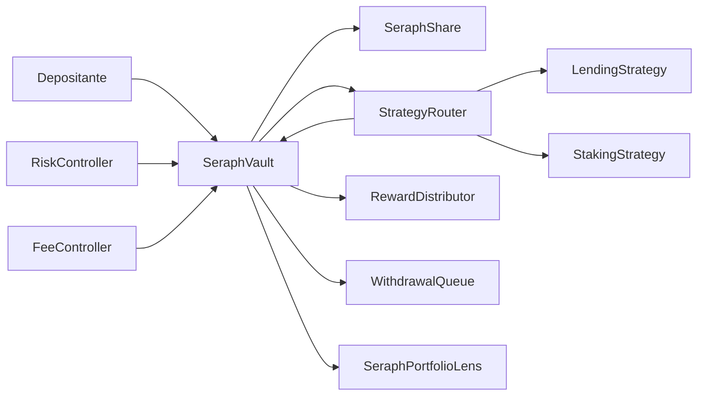

# SeraphYieldProtocol


Sistema modular de participaciones y rendimiento en Solidity 0.8.26. `SeraphVault` recibe el activo, emite shares y coordina estrategias, distribución de recompensas, comisiones y retiros diferidos. El repositorio incluye pruebas Foundry reproducibles y herramientas de lectura; no identifica un despliegue de red ni custodias externas.

## Arquitectura



El vault aplica límites y coordina capital. El router contabiliza deuda por estrategia y sus pesos objetivo. El distribuidor usa un índice acumulativo para asignar rendimiento. La cola registra solicitudes y ventanas de retiro. `SeraphPortfolioLens` ofrece observación de activos, deuda, presión de cola y un estrés determinista sin modificar estado.

## Contabilidad económica

La conversión de activos a shares utiliza activos y shares virtuales para evitar ratios indefinidos cuando no existe suministro. El rendimiento realizado se reparte entre comisión de desempeño, rewards y capital compuesto. Con ganancia económica de 100 unidades, comisión del 10 % y asignación del 50 % del remanente, el resultado es: 10 de comisión, 45 financiadas como rewards y 45 retenidas. La comisión de gestión, si está configurada, se contabiliza por tiempo. Los cálculos redondean hacia abajo cuando la operación lo requiere.

Para un estrés del 20 % sobre deuda de estrategia y redención del 50 % del patrimonio, la lente calcula patrimonio tras pérdida, solicitud estimada, brecha de caja inmediata y brecha patrimonial. Es una simulación contable: no pronostica el tiempo de salida de una estrategia. Véase [modelo económico](docs/modelo-economico.md).

## Desarrollo y verificación

Requiere Foundry y Solidity 0.8.26. La dependencia `forge-std` se fija a `v1.9.6`.

```bash
forge install foundry-rs/forge-std@v1.9.6 --no-git --shallow
forge fmt --check
forge build --sizes
forge test -vvv
```

En Windows puede ejecutar `forge.exe` desde PowerShell; los scripts de `scripts/` requieren Bash. `bash scripts/ci.sh` reproduce el pipeline y usa el perfil `ci` para fuzz e invariantes. `script/DeploySeraph.s.sol` sirve para simulaciones locales; este release no ejecuta `--broadcast` ni implica autorización para redes o fondos ajenos.

## Lecturas de tesorería

Tras instanciar `SeraphPortfolioLens` con la dirección del vault inicializado, `snapshot()` devuelve patrimonio, caja, deuda, shares activos y en cola, cobertura inmediata y fecha del último harvest. `strategies()` devuelve deuda, cap y peso de cada estrategia. `stress(2000, 5000)` representa pérdida del 20 % sobre deuda y redención del 50 %. Los parámetros están expresados en puntos básicos; 10 000 equivale al 100 %.

## Documentación

- [Arquitectura y responsabilidades](docs/arquitectura.md)
- [Modelo económico y ejemplo numérico](docs/modelo-economico.md)
- [Operación, pruebas y observabilidad](docs/operacion.md)
- [Controles de seguridad](docs/controles-seguridad.md)
- [Política de seguridad](SECURITY.md)

`main`, la rama `production`, el tag anotado `v1.0.0` y el release se comprueban por separado. Su coincidencia identifica la revisión publicada, no una auditoría externa ni un despliegue en red.
