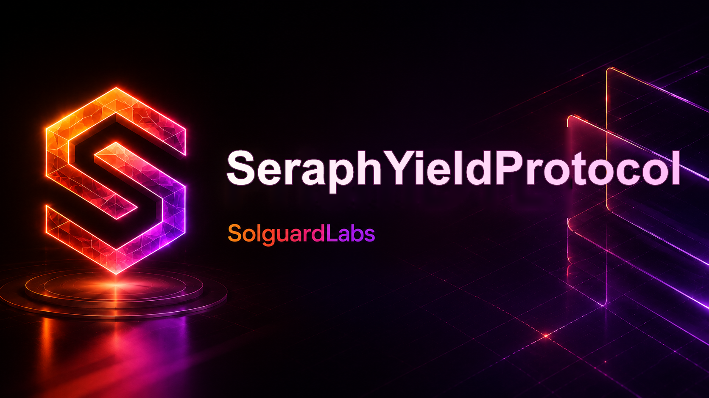

# SeraphYieldProtocol



SeraphYieldProtocol es un agregador modular de rendimiento escrito en Solidity. El protocolo
emite participaciones sobre los activos depositados, distribuye la liquidez entre estrategias
compatibles, contabiliza las recompensas y procesa las salidas mediante una cola diferida.

El repositorio está diseñado para separar con claridad la custodia, la asignación de capital,
el control de riesgo y la contabilidad de recompensas. Cada módulo expone una responsabilidad
acotada y puede probarse de forma aislada.

> **Estado del proyecto:** software experimental. No utilizar con fondos reales sin una revisión
> independiente, pruebas adicionales y una configuración operativa adecuada.

## Características

- Depósitos y retiros coordinados por un vault ERC-4626-like.
- Token de participaciones dedicado para representar la posición del depositante.
- Enrutamiento de capital entre múltiples estrategias con límites configurables.
- Estrategias de referencia para lending y staking.
- Índice acumulativo para distribuir recompensas de forma eficiente.
- Cola de retiros diferidos con ciclo de solicitud, cancelación y liquidación.
- Controles separados para riesgo, comisiones y operación de emergencia.
- Pruebas unitarias y de integración con Foundry.

## Arquitectura

| Componente | Responsabilidad |
| --- | --- |
| `SeraphVault` | Punto de entrada para depósitos, redenciones y coordinación del protocolo. |
| `SeraphShare` | Tokeniza las participaciones de los depositantes. |
| `StrategyRouter` | Asigna, rebalancea y recupera capital de las estrategias autorizadas. |
| `BaseStrategy` | Interfaz y comportamiento común de las estrategias. |
| `LendingStrategy` | Adaptador de referencia para una fuente de rendimiento tipo lending. |
| `StakingStrategy` | Adaptador de referencia para una fuente de rendimiento tipo staking. |
| `RewardDistributor` | Registra y distribuye recompensas mediante un índice acumulativo. |
| `WithdrawalQueue` | Gestiona el ciclo de vida de las solicitudes de retiro diferido. |
| `RiskController` | Aplica límites de exposición, pausas y restricciones operativas. |
| `FeeController` | Calcula y recauda las comisiones configuradas. |

Flujo principal:

1. El usuario deposita el activo subyacente en `SeraphVault` y recibe `SeraphShare`.
2. `StrategyRouter` asigna el capital disponible entre estrategias habilitadas.
3. Las estrategias reportan su valoración y el rendimiento realizado.
4. `RewardDistributor` actualiza la contabilidad de recompensas.
5. Los retiros diferidos se solicitan y procesan a través de `WithdrawalQueue`.

## Requisitos

- [Foundry](https://getfoundry.sh/) estable (`forge`, `cast` y `anvil`).
- Git.
- Solidity `0.8.26` (Foundry descarga el compilador cuando sea necesario).

## Instalación

```bash
git clone <URL_DEL_REPOSITORIO>
cd SeraphYieldProtocol
forge install foundry-rs/forge-std --no-git
forge build
```

## Uso habitual

```bash
# Formatear el código
forge fmt

# Compilar y mostrar tamaños de contrato
forge build --sizes

# Ejecutar todas las pruebas
bash ./scripts/tests.sh

# Ejecutar la misma validación utilizada en CI
bash ./scripts/ci.sh

# Ejecutar una prueba concreta
forge test --match-test testNombreDeLaPrueba -vvvv

# Generar un informe de gas
forge test --gas-report
```

En Windows, los scripts pueden ejecutarse desde Git Bash o WSL. Los comandos `forge` también
pueden lanzarse directamente desde PowerShell.

## Configuración

La configuración principal se encuentra en `foundry.toml`:

- perfil `default`: desarrollo local, optimizer activado y EVM Cancun;
- perfil `ci`: más ejecuciones fuzz e invariantes para validación automatizada;
- formato: líneas de 100 caracteres e indentación de cuatro espacios para Solidity.

Los parámetros económicos y operativos deben establecerse de acuerdo con el activo, la liquidez
de las estrategias y el entorno de despliegue. Antes de desplegar, revise al menos:

- límites por estrategia y exposición total;
- ventanas y capacidad de procesamiento de retiros;
- destinatario y magnitud de las comisiones;
- roles administrativos, guardianes y proceso de rotación;
- fuentes de valoración y comportamiento ante estrategias ilíquidas;
- procedimientos de pausa, recuperación y migración.

## Despliegue

`script/DeploySeraph.s.sol` despliega los módulos, conecta el hook de recompensas, autoriza la
cola y completa la inicialización atómica del vault. La simulación puede ejecutarse con:

```bash
PRIVATE_KEY=<clave-local> \
SERAPH_ASSET=<activo-erc20> \
forge script script/DeploySeraph.s.sol:DeploySeraph --rpc-url <rpc> -vvvv
```

Para emitir transacciones, añada `--broadcast`. El script admite variables `SERAPH_*` para los
roles, ventanas de retiro, límites de riesgo, comisiones y metadatos del token de shares.

## Estructura del repositorio

```text
.
├── src/                 # Contratos del protocolo
│   ├── core/            # Vault, cola, router, rewards, riesgo y comisiones
│   ├── interfaces/      # Interfaces públicas
│   ├── libraries/       # Matemáticas, transferencias y utilidades
│   ├── security/        # Roles y protección contra reentrada
│   ├── token/           # Token de participaciones
│   ├── types/           # Estructuras y enumeraciones compartidas
│   └── strategies/      # Implementaciones de estrategias
├── test/                # Pruebas unitarias y de integración
├── script/              # Despliegue Foundry
├── scripts/             # Comandos locales y de integración continua
├── foundry.toml         # Configuración de Foundry
└── remappings.txt       # Remappings de dependencias
```

## Licencia

Este proyecto se distribuye bajo la licencia MIT. Consulte [LICENSE](LICENSE).
