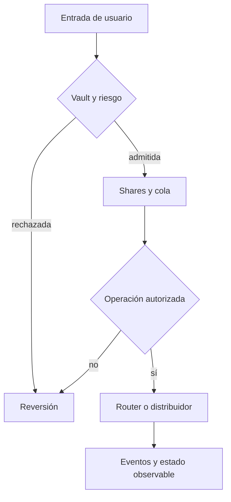

# Política de seguridad de SeraphYieldProtocol

## Límites de confianza

El vault custodia el activo y controla mint, burn, retiros y harvest. El router solo recibe órdenes autorizadas del vault; las estrategias se registran y limitan individualmente. `RiskController` fija límites de depósito, cola, shares activos, caja mínima y pérdidas reportadas. `FeeController` limita tasas y destinatario. El guardián puede restringir operaciones; la reanudación y la ampliación de límites requieren autoridad de gobierno según el módulo.

## Revisión de invariantes

- El suministro de shares corresponde a las posiciones emitidas y quemadas.
- Las shares bloqueadas no son transferibles; la cola conserva su estado hasta cancelación o ejecución.
- El patrimonio del vault se calcula como caja más deuda contabilizada del router.
- Los reportes de estrategias respetan límites de pérdida y caps configurados.
- Las tarifas no exceden los límites del controlador.
- Los rewards financiados y los pagos se observan por separado.
- Una lente de lectura no autoriza movimientos ni cambia estado.

Los controles agregados no sustituyen pruebas de secuencias operativas completas. Para un cambio económico, compruebe transiciones intermedias además del resultado final.

## Avisos privados

Utilice el canal privado **Report a vulnerability** de GitHub si está habilitado. Incluya commit, parámetros, reproducción mínima, resultado esperado y observado e impacto. No incluya claves, datos personales o fondos reales; no publique detalles técnicos antes de coordinar una corrección. Esta política no autoriza probar sistemas de terceros.
