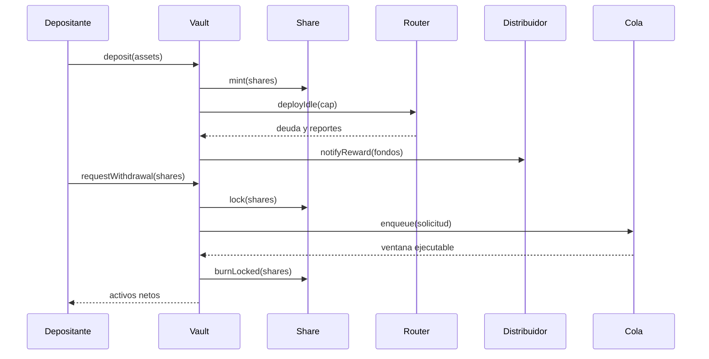

# Arquitectura y ciclo de vida

`SeraphVault` coordina todas las mutaciones del patrimonio. `SeraphShare` registra propiedad y bloqueo de participaciones. `StrategyRouter` mantiene deuda contable por estrategia, caps y pesos. `RewardDistributor` mantiene un índice global y checkpoints individuales. `WithdrawalQueue` gestiona solicitudes, ventanas y rondas. Los controladores de riesgo y comisiones aportan límites explícitos. `SeraphPortfolioLens` es una vista externa sin permisos de mutación.

Una orden de retiro transita por `Pending`, `Claimable`, `Claimed` o `Cancelled`; las ventanas se basan en tiempos de solicitud y vencimiento. Los eventos no sustituyen el estado de almacenamiento. Las interacciones entre módulos se validan con tests de integración sobre el mismo vault.
