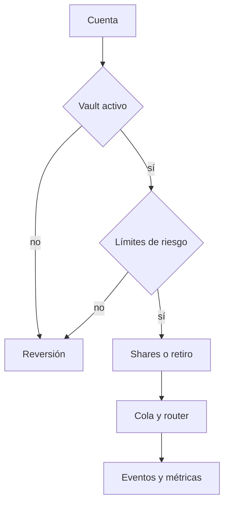

# Controles y límites

La entrada de depósitos se valida contra cap y pausas. Las solicitudes de retiro validan balance, cupo global, cupo por cuenta y mínimo de shares activos. El router impone caps, pesos, permisos de keeper y límites de pérdida por estrategia. El distribuidor registra financiación y pagos con índice acumulativo. Los roles de gobernador y guardián no son intercambiables en todas las operaciones.

Pruebas de revisión económica deben variar usuarios, estrategias con pesos distintos, reportes de pérdidas, caja insuficiente y ventanas de retiro. Un test de un único estado final no cubre intercalaciones. Compruebe además que las sumas de deuda del router, los saldos del vault, las shares bloqueadas y los fondos del distribuidor responden a sus propias unidades.

`SeraphPortfolioLens` no tiene funciones de escritura: sus métricas son observación, no frenos de emergencia. Un estrés de pérdida uniforme sobre la deuda es un supuesto explícito, no una valoración de mercado. La aprobación de cambios requiere CI, revisión de parámetros y evaluación separada del commit final; publicación no equivale a auditoría independiente.
