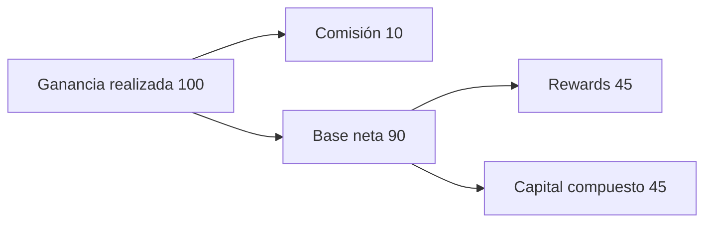

# Modelo económico

## Conversión de participaciones

El vault usa reservas virtuales: `shares = floor(assets × (supply + virtualShares) / (assetsTotales + virtualAssets))` para depósitos; la operación inversa estima activos. Los límites `minimumShares` y `maximumAssets` permiten al usuario acotar el deslizamiento aceptado. La contabilidad del vault suma caja y deuda del router, no valoraciones externas instantáneas.

## Waterfall de harvest

La ganancia económica se calcula sobre ganancia realizada y pago de deuda reportados, neta de pérdida aplicable. Después se calcula comisión de desempeño; la asignación de rewards se aplica al remanente. Para 100 unidades de ganancia económica, comisión del 10 %, reparto de rewards del 50 % y comisión de gestión cero:

```text
comisión de desempeño = 100 × 10 % = 10
base después de comisión = 100 − 10 = 90
rewards financiados = 90 × 50 % = 45
capital retenido = 100 − 10 − 45 = 45
```



La tarifa de gestión es un cálculo temporal adicional si su tasa no es cero. Las operaciones con enteros redondean de forma explícita; los ejemplos numéricos asumen unidades compatibles con el activo subyacente.

## Presión de retiros y estrés

La lente mide `coberturaBps = floor(caja × 10 000 / activosEstimadosEnCola)` y `deudaBps = floor(deuda × 10 000 / activosTotales)`, con cero cuando el denominador no existe. Para un vault con 1 000 activos, 100 de caja y 900 de deuda, una pérdida del 20 % sobre deuda deja 820 activos. Una redención del 50 % demanda 500; brecha de caja inmediata 400 y brecha patrimonial cero. La recuperación real de estrategias puede tardar o producir menos activos; la fórmula no predice liquidez temporal.
